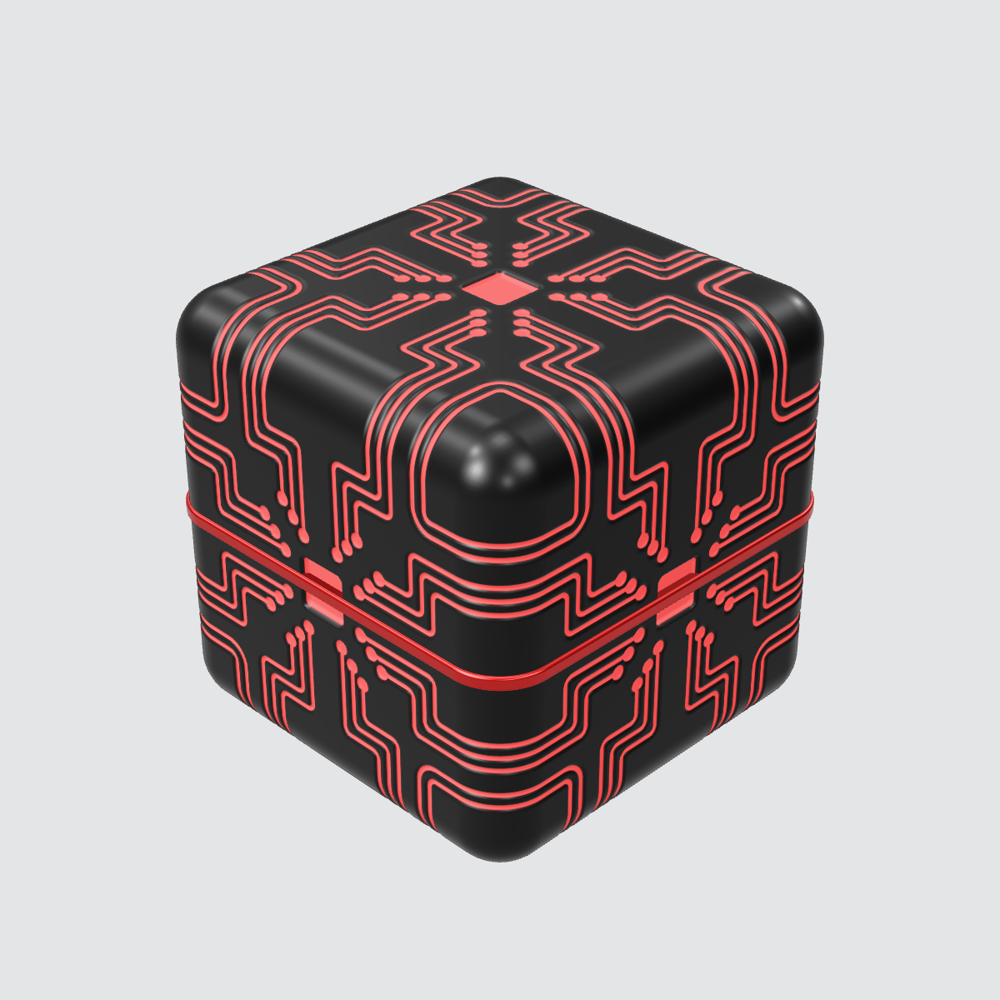

# Hostooze Core

A premium rounded cube for the Hostooze brand, generated entirely in code with three.js.



| File | What it is |
| --- | --- |
| `hostooze-core.js` | The model. `createHostoozeCore()` builds it procedurally and returns a `THREE.Group`. |
| `index.html` | Studio viewer: light grey stage, soft lighting, isometric three-quarter view, slow rotation, drag to orbit. |
| `hostooze-core.glb` | Exported model for Blender, Spline, Unity, Unreal, model-viewer, etc. |
| `build.mjs` | Re-renders `renders/*.png` and re-exports the `.glb` from the code. |
| `renders/` | Preview images. |

## Design

- Cube with edge 2 units and a 0.24 bevel radius (12% of the size).
- Six identical faces. Each face is one arm of circuit traces repeated with 4-fold rotation and mirroring. Every edge is crossed at the same symmetric positions (±0.30, ±0.36, ±0.42, ±0.54, ±0.60), so the traces continue over the edges onto the neighbouring faces. Corner traces join into loops around each vertex of the cube.
- The grooves, round nodes and centre panel are real recesses in the mesh, not just texture: 0.012 deep for traces and 0.028 for the panel.
- A polished seam ring wraps the equator.
- Colours: charcoal `#242424` satin anodized body; brand red `#E24747` in every groove, node and panel (softly emissive), and on the ring.
- A second finish, `light` ("Porcelain"), copies the look of the reference render: an off-white body with a charcoal ring.

## Use it in code

```js
import * as THREE from 'three';
import { createHostoozeCore } from './hostooze-core.js';

const core = createHostoozeCore({ res: 256, texture: 2048, palette: 'brand' });
scene.add(core);
core.userData.setPalette('light'); // switch finish at runtime
```

`res` sets the grid cells per face (256 gives about 790k triangles). Lower it for mobile.

## Run the viewer

ES modules need a local server:

```sh
cd hostooze-core
python3 -m http.server 8000   # open http://localhost:8000
```

URL options: `?palette=light`, `?spin=0`, `?yaw=30`, `?res=192`.

## Rebuild renders and the .glb

```sh
npm i playwright three@0.169.0 && npx playwright install chromium
node build.mjs            # add --no-renders or --no-glb to skip a step
```
